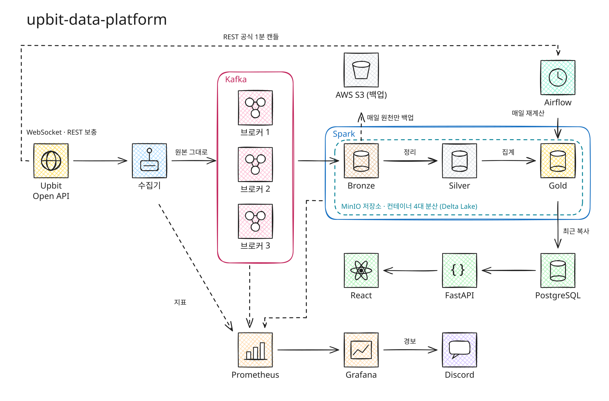

# 업비트 실시간 시장 이상 신호 플랫폼

업비트 KRW 전체 마켓의 실시간 거래 데이터를 Kafka와 Spark로 수집·정제하고, 2주 동안 연속 운영하면서 모니터링으로 유실·중복·정확성·지연·장애 회복을 수치로 검증한 뒤, 그 2주 데이터로 코인별 "다음 5분 급변동 확률" 예측이 되는지 확인하는 데이터 엔지니어링 + ML 프로젝트입니다.

- 작성일: 2026-11-24 · 갱신: 2026-11-26
- 상태: **설계 결정과 저장소 규칙 완료, 0단계(데이터 측정) 착수**
- 흐름: DE 구축 → 2주 연속 운영 → 2주 데이터로 ML 확인 → 문서 정리 → 종료
- 규모: 1인, PC 1대 (RAM 32GB, RTX 5070)

## 한 문장 목표

> 실시간 거래 데이터를 유실·중복 없이 받아 믿을 수 있는 분석용 테이블과 AI 학습용 데이터셋으로 만들고, 그 위에서 예측 → 자동 채점 → 재학습이 도는 운영 가능한 파이프라인을 구축하고 수치로 검증한다.

## 아키텍처

- 수집기는 받은 메시지를 **가공하지 않고** Kafka에 넣습니다. Bronze·Silver·Gold는 모두 Spark가 만듭니다.
- 원본이 Kafka(3일)와 Bronze(전부)에 남으므로, Spark 코드를 고치면 Bronze부터 다시 계산할 수 있습니다.
- 수집 데이터는 PC 밖으로 나가지 않습니다. GitHub에는 코드와 문서만 올립니다.
- 그림 원본: [docs/architecture.excalidraw](docs/architecture.excalidraw) ([excalidraw.com](https://excalidraw.com)에서 열어 고칠 수 있습니다). 구성 설명은 [03_시스템아키텍처.md](docs/03_시스템아키텍처.md)에 있습니다.

## 이 프로젝트는 무엇이고, 무엇이 아닌가

| 구분 | 내용 |
|---|---|
| **이것이다** | 실시간 데이터 파이프라인 + **단기 변동성 예측**(지도학습 분류) + **주기적 재학습(CT) 파이프라인** |
| 주기적 재학습의 뜻 | 새 데이터가 쌓이면 학습셋 스냅샷을 만들어 **처음부터 다시 학습** → 기존 운영 모델과 비교 → 나을 때만 **재배포**. 배포 사이에는 모델이 고정됨 |
| 범위 | 결정의 현재 상태는 [09_결정현황.md](docs/09_결정현황.md)가 기준. 재학습(CT)의 실제 범위는 ML 단계 시작 전에 2주 데이터 기준으로 다시 정함 |
| 아니다 | **이상거래 탐지**가 아님 (정답이 없는 비지도 문제라 제외) |
| 아니다 | **온라인 학습**이 아님 (데이터마다 가중치를 갱신하지 않음). 어제 모델에 이어서 학습하지도 않음 |
| 아니다 | **Continual Learning**(망각 없이 계속 배우는 연구 분야)이 아님 |

## 작업 규칙

진행 상황은 [STATE.md](STATE.md), 저장소 지도는 [STRUCTURE.md](STRUCTURE.md), 커밋·측정 기록 규칙은 [docs/RULES.md](docs/RULES.md)에 있습니다.

## 문서

| 문서 | 내용 |
|---|---|
| [01_초기기획서.md](docs/01_초기기획서.md) | 기획서: 배경, 목표, 범위, 데이터 이용 원칙, 성공 기준, 단계, 운영 규칙, 리스크 |
| [02_주제_문제정의.md](docs/02_주제_문제정의.md) | 예측 대상, 라벨 정의, 평가 방법 |
| [03_시스템아키텍처.md](docs/03_시스템아키텍처.md) | 구성요소, 데이터 흐름, 저장 용량, 배치 단계(L0/L1/L2), 장애 대응 |
| [04_데이터명세서.md](docs/04_데이터명세서.md) | 원천 데이터 필드, Kafka 메시지, Bronze/Silver/Gold 테이블 컬럼 |
| [05_ML_MLOps설계.md](docs/05_ML_MLOps설계.md) | 피처, 라벨, 분할, 모델, 평가, 서빙, 채점, 드리프트, 재학습 |
| [06_신뢰성검증계획.md](docs/06_신뢰성검증계획.md) | 장애·중복·지연 시험, 공식 캔들 대사, 운영 보고서 양식 |
| [07_단계별실행계획.md](docs/07_단계별실행계획.md) | 0~8단계 작업과 완료 기준 |
| [08_결정기록_ADR.md](docs/08_결정기록_ADR.md) | 기술 선택 이유와 바꿀 조건 |
| [09_결정현황.md](docs/09_결정현황.md) | 설계 결정의 현재 상태(확정·제안·미정)와 근거 측정. 01~08과 다르면 이 문서가 우선 |
| [10_한계.md](docs/10_한계.md) | 이 프로젝트로 말할 수 없는 것과 알고 받아들인 제약 |

## 측정 결과 (0단계)

우리 수집 시스템을 잰 값입니다. 업비트 시세 데이터 자체는 올리지 않습니다. 모든 숫자의 원본은 원장 [`experiments/LEDGER.tsv`](experiments/LEDGER.tsv)이고, 사람이 읽는 요약은 [`notes/00_data_profile.md`](notes/00_data_profile.md), 데이터 구조(필드·Kafka 메시지·테이블 열)는 [04_데이터명세서.md](docs/04_데이터명세서.md)에 있습니다.

KRW 전체 301개 마켓, 종류별 연결 3개, 30분 (2026-11-26 평일 오전, 원장 `R20261126-013825-c63b1b`):

| 항목 | 결과 |
|---|---|
| 초당 메시지 | 체결 36.6 · 호가 263.7 · 현재가 52.8 |
| 지연 (업비트 시각 → 수신) | p50 53~63ms · p99 98~131ms (PC 시계 동기화 후) |
| 호가 단계 | 전부 30단계 |
| 하루 용량 (수집기 1대분) | 원본 약 68.5GB, gzip 약 15.8GB (호가가 약 97%) |
| 재연결 | 다시 붙을 때마다 마켓별 마지막 체결을 다시 보냄 → 같은 체결 498건 (Silver에서 `sequential_id`로 제거) |
| 업비트가 스스로 끊은 연결 | 30분에 2번, 연결마다 따로 (체결 1, 호가 1) |
| 체결 없는 분 | 마켓별 중앙값 29분 중 20분 |

남은 질문(24시간 연결, 침묵 감지 기준 초 등)은 [notes/00_data_profile.md](notes/00_data_profile.md) 4절과 [09_결정현황.md](docs/09_결정현황.md) 11절에 있습니다.

## 저장소 정책

- 시세 데이터의 저작권은 두나무에 있습니다(업비트 Open API 이용약관 제5조). 수집한 원본 데이터, 가공 데이터셋, 모델 파일은 저장소에 올리지 않고, 코드·문서·재현 스크립트와 시스템 지표만 포함합니다.
- 비상업 개인 프로젝트이며, 데이터 출처는 업비트 Open API 시세입니다.
- API 키나 비밀 값은 커밋하지 않습니다. (시세 조회는 키가 필요 없습니다.)
- 이 프로젝트는 데이터 플랫폼이며 투자 권유나 자동매매 도구가 아닙니다.
