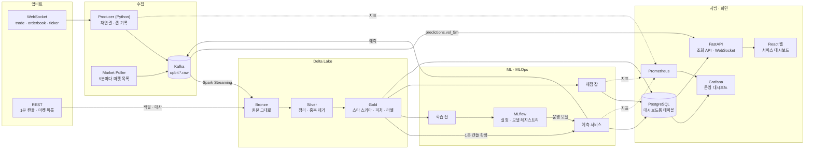
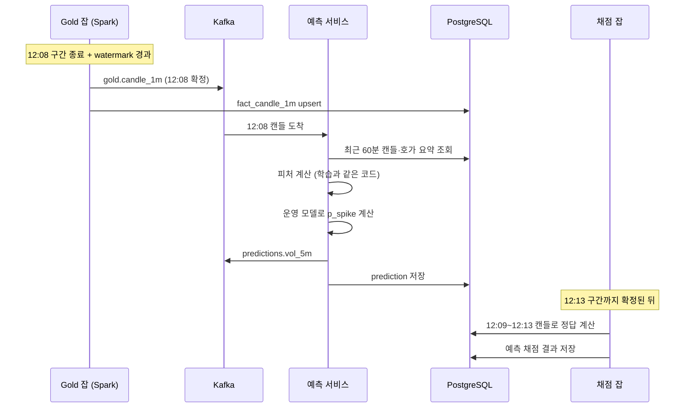
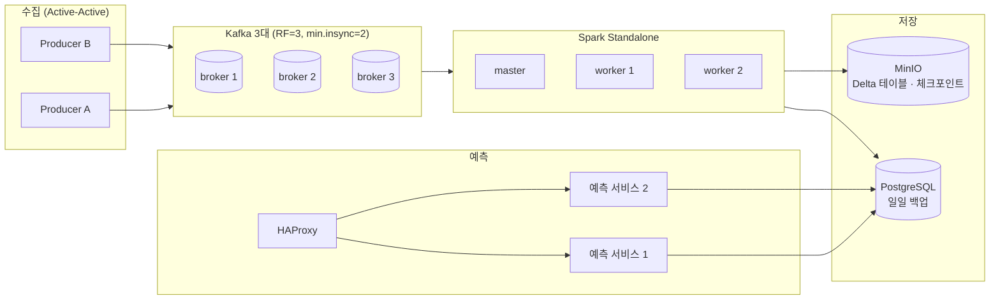

# 03. 시스템 아키텍처

> 결정의 현재 상태는 [09_결정현황.md](09_결정현황.md)가 기준입니다. 이 문서와 다르면 09가 우선합니다.

## 1. 설계 원칙

1. **원본은 바꾸지 않는다.** 문제가 생기면 Bronze부터 다시 처리할 수 있어야 한다.
2. **중복과 지연은 생긴다고 가정한다.** 재연결 시 업비트가 직전 체결을 다시 보내는 것을 확인했다.
3. **실시간은 빠르게, 정확성은 재계산으로.** 실시간 결과는 빠르게 보여주고, 매일 재계산으로 늦게 온 데이터를 보정한다.
4. **학습과 서빙은 같은 피처 코드를 쓴다.** 학습 때와 운영 때의 피처 계산이 다르면 모델이 운영에서 엉뚱하게 동작한다.
5. **돌아가는 것을 먼저 만들고 도구는 나중에 붙인다.** 수집기 2대와 Kafka 3대는 처음부터 두고, 그 밖의 이중화(Spark 워커, 예측 서비스, MinIO)는 필요할 때 붙인다.

## 2. 전체 구성

### 흐름 요약
1. **수집**: Producer가 WebSocket을 받아 Kafka에 넣습니다. Market Poller는 5분마다 마켓 목록(주의 표시 포함)을 Kafka에 넣습니다.
2. **Bronze**: Spark Structured Streaming이 Kafka를 읽어 원본 그대로 Delta 테이블에 저장합니다.
3. **Silver**: 컬럼으로 풀고, 타입·시각을 맞추고, 체결 번호로 중복을 제거합니다. 불량 데이터는 격리합니다.
4. **Gold**: 1분 캔들 팩트, 호가 1분 요약, 마켓·시간 차원, 피처와 라벨 테이블을 만듭니다.
5. **예측**: 1분 캔들이 확정되면 예측 서비스가 피처를 계산하고 운영 모델로 예측합니다.
6. **채점**: 5분 뒤 실제 결과가 나오면 예측이 맞았는지 채점합니다.
7. **학습**: 매일 최신 데이터로 새 모델을 학습하고, 기존 모델보다 나을 때만 교체합니다.
8. **구현 순서**: 수집 → Bronze → Prometheus·Grafana → Silver → Gold → PostgreSQL → FastAPI·React ([09 문서 1절](09_결정현황.md)). 7번(학습)과 5~6번(예측·채점)은 2주 운영 뒤 ML 단계에서 범위를 다시 정합니다.
9. **화면**: 서비스 대시보드(React 웹)는 FastAPI를 통해 데이터를 받습니다. 과거 데이터는 REST로 PostgreSQL에서 조회하고, 새 예측은 FastAPI가 Kafka `predictions.vol_5m` 토픽을 구독해 WebSocket으로 바로 밀어 줍니다. 운영 대시보드(Grafana)는 PostgreSQL과 Prometheus(시스템 지표)를 읽어 파이프라인과 모델 상태를 보여줍니다.

## 3. 구성요소

| 구성요소 | 역할 | 기술 | 상시 실행 |
|---|---|---|---|
| Producer | WebSocket 수신, Kafka 발행, 재연결, 갭 기록. 2대 동시 수집. 수집기마다 종류별 연결 3개. 5분마다 마켓 목록을 직접 확인해 바뀌면 구독을 다시 보냄. 데이터가 끊긴 연결은 다시 연결하고, Kafka에 못 쓰는 동안 로컬 파일에 쌓아 둠 | Python | 예 |
| Market Poller | 마켓 목록·주의 표시를 5분마다 수집 | Python | 예 |
| Kafka | 수집과 처리 사이의 버퍼, 재처리용 3일 보관. 브로커 3대 | Kafka (KRaft 모드) | 예 |
| Bronze 잡 | Kafka → Bronze | Spark Structured Streaming | 예 |
| Silver 잡 | Bronze → Silver | Spark Structured Streaming | 예 |
| Gold 잡 | Silver → 1분 캔들·호가 요약 | Spark Structured Streaming | 예 |
| 일일 재계산 | 전날 Gold를 Silver로부터 다시 계산 | Spark (배치) | 하루 1회 |
| 대사 잡 | 직접 만든 1분 캔들과 공식 캔들 비교 | Spark 또는 Python | 하루 1회 |
| 예측 서비스 | 피처 계산, 모델 로드, 예측 | Python (FastAPI 또는 컨슈머) | 예 |
| 채점 잡 | 예측과 실제 결과 비교 | Python | 1분마다 |
| 학습 잡 | 학습셋 스냅샷 생성, 학습, 평가, 등록 | Spark + LightGBM | 하루 1회 |
| MLflow | 실험 기록, 모델 레지스트리 | MLflow | 예 |
| PostgreSQL | 화면용 테이블(`serve_*`), MLflow·Airflow 메타데이터 | PostgreSQL | 예 |
| Prometheus | 시스템 지표 수집 | Prometheus | 예 |
| 운영 대시보드 | 파이프라인·모델 상태 감시 | Grafana | 예 |
| 조회 API | 화면용 REST 조회, 새 예측 WebSocket 전송 | FastAPI | 예 |
| 서비스 대시보드 | 코인별 위험도, 가격·위험도 차트, 예측 vs 실제 | React + TypeScript (Vite) | 예 |
| 오케스트레이션 | 일일 재계산·대사·공백 보충 | Airflow (메모리가 모자라면 cron) | 예 |

### 왜 Grafana가 Delta 테이블을 직접 읽지 않나
Grafana는 Delta Lake를 직접 읽는 기본 데이터 소스가 없습니다. 또 대시보드는 "최근 몇 시간"만 빠르게 읽으면 됩니다. 그래서 **Gold의 최근 데이터와 예측 결과를 PostgreSQL에 함께 써 두고**(Spark `foreachBatch`로 upsert), Grafana는 PostgreSQL만 읽습니다. 장기 보관과 학습은 Delta, 화면 표시는 PostgreSQL로 역할을 나눈 것입니다.

## 4. 실시간 예측 흐름

### 예측 지연과 정확성의 균형
1분 구간이 끝나도, 늦게 도착하는 체결을 위해 **watermark만큼 기다린 뒤** 캔들을 확정합니다. watermark가 길수록 정확하지만 예측이 늦어집니다. 초기값은 30초로 가정하고, 0~2단계에서 실제 지연 분포를 재서 확정합니다.

### 학습·서빙 불일치 방지
- 피처 계산은 **Python 함수 하나**로 만들고, 학습(Spark `applyInPandas`로 마켓별 실행)과 예측 서비스(pandas)에서 같은 함수를 import합니다.
- 운영 중 예측에 쓴 피처 값을 그대로 저장해 두고, 나중에 같은 시각을 배치로 다시 계산한 값과 비교합니다. 차이가 있으면 늦게 온 데이터 때문인지, 코드 차이 때문인지 확인합니다.

## 5. 저장 계층

| 계층 | 무엇을 | 쓰기 방식 | 보관 |
|---|---|---|---|
| Kafka | 원본 메시지 | 추가 (zstd 압축) | 3일 |
| Bronze | 원본 JSON + Kafka 메타데이터 | 추가만 | 2주 수집분 전부 (호가 30줄 원본 포함, 삭제 없음) |
| Silver | 정리된 체결·호가 요약·현재가·마켓 상태 | MERGE (중복 제거) | 전부 |
| Gold | 스타 스키마, 피처, 라벨, 학습셋 스냅샷 | MERGE·덮어쓰기(파티션 단위) | 전부, 학습에 쓴 버전은 보존 |
| PostgreSQL | 화면용 최근 복사본 (캔들, 호가 요약, 마켓 목록, 일치율. 예측·채점은 ML 단계) | upsert | 최근 30일 (초안, 근거 없음) |

컬럼 단위 정의는 [04_데이터명세서.md](04_데이터명세서.md)에 있습니다.

### 5.1 저장 용량

KRW 전체 기준 값입니다. 근거 측정은 [09 문서 10절](09_결정현황.md)(M8)과 3절에 있습니다.

| 종류 | 하루 (압축 후) | 근거 |
|---|---|---|
| 호가 (30단계) | 약 11.8GB | 계산 |
| 현재가 | 약 0.29GB | 실측 60초 표본 환산 (M8) |
| 체결 | 약 0.09GB | 실측 60초 표본 환산 (M8) |
| **Bronze 합계** | **약 12.2GB** | 계산 |

**용량의 대부분이 호가 원본**입니다. 2주 운영 기준 사용량입니다.

| 위치 | 2주 사용량 (계산) | 비고 |
|---|---|---|
| Bronze | 약 171GB | 삭제 없음 |
| Silver | 약 14GB | 하루 약 1GB 추정 (미측정). 호가는 30줄을 펼치지 않고 1행 요약 |
| Kafka | 약 110GB | 3일 보관 × 복제 3벌 |
| **합계** | **약 295GB** | 여유 1,444GB(실측) 중 약 1,149GB 남음, 전체의 약 62% |

1단계에서 실제 디스크 사용량을 재서 이 표를 갱신합니다.

**저장 압축은 모델 압축(저비트 양자화)과 다릅니다.** 가격·거래량 원본은 `DECIMAL`로 정확히 보존해야 공식 캔들 대사가 가능하므로, 값을 줄이지 않고 **파일 압축과 보관 기간**으로만 용량을 관리합니다.

### 5.2 재학습·배포 부하

| 작업 | 부하 (추정) |
|---|---|
| 매일 재학습 (LightGBM, 약 20만 행) | CPU로 수 초~1분 |
| Walk-forward 검증 (14회 반복) | 수 분 |
| 학습셋 생성 (Spark 배치) | RAM 수 GB를 잠깐 사용 → 새벽에 실행 |
| 재배포 | 모델 파일 수 MB 로드 + `champion` 별칭 변경 |
| GPU | LightGBM에는 쓰지 않음. 선택 실험(GRU, Qwen 해설)에서만 사용 |

부담이 될 수 있는 것은 RAM입니다. L1 구성(9절, 16~23GB 추정)에서 학습을 동시에 돌리면 빠듯할 수 있으므로 학습은 수집 부하가 낮은 시간대에 실행합니다.

## 6. 배치 단계: L0 → L1 → L2

| 단계 | 구성 | 지켜주는 것 | 못 지키는 것 |
|---|---|---|---|
| **L0** 시작 구성 | 수집기 2대, Kafka 브로커 3대, 나머지는 1개씩 (Spark local), 저장은 로컬 디스크 | 수집기 1대·브로커 1대가 죽어도 수집 계속. Spark는 재시작 후 체크포인트에서 이어서 처리 | Spark·DB가 죽어 있는 동안 처리 중단 |
| **L1** 추가 이중화 (미정) | L0 + Spark 워커 2대, 예측 서비스 2대 + HAProxy, MinIO | 구성요소 하나가 죽어도 서비스 계속 | PC 자체가 꺼지면 중단 |
| **L2** 다중 장비 (범위 밖) | PC 2대 이상 또는 클라우드, Kubernetes | 장비 장애에도 계속 | 비용·운영 부담 증가 |

L1은 한 PC 안의 복제라서 **프로세스 장애는 막지만 장비 장애는 막지 못합니다.** 이 한계는 [10_한계.md](10_한계.md)에 적습니다.

### L1 배치도

## 7. 장애 대응

| 구성요소 | L0 | L1 | 죽었을 때 |
|---|---|---|---|
| Producer | 2대 동시 수집, 자동 재시작 | 같음 | 다른 한 대가 계속 수집, 중복은 Silver가 제거. 두 대가 같이 끊긴 구간만 갭으로 기록하고 REST 캔들로 백필 |
| Kafka | 3대, 복제 3, 최소 동기 복제 2, `acks=all` | 같음 | 1대가 죽어도 계속. 2대가 죽으면 유실 대신 쓰기 거부 |
| Spark 잡 | 자동 재시작 | 워커 2대 | 체크포인트에서 이어서 처리. 그동안 데이터는 Kafka에 쌓임 |
| 예측 서비스 | 1대 | 2대 + HAProxy | L1: 죽은 쪽을 자동으로 제외 |
| PostgreSQL | 일일 백업 | 일일 백업 + 복원 시험 | 화면이 멈추지만 수집·정제는 계속 |
| 저장소 | 로컬 디스크 | MinIO | 쓰기 실패 시 재시도, Kafka 7일 보관이 복구 여유 |

복구 목표:
- **RPO** (허용 데이터 손실): 수집기가 하나라도 살아 있던 구간은 0. 모든 수집기가 죽은 구간은 갭으로 기록하고 REST 캔들로 1분 단위까지만 백필합니다.
- **RTO** (복구 시간): 구성요소별로 실측해서 기록합니다.

## 8. 확장성

| 늘어나는 것 | 대응 | 주의 |
|---|---|---|
| 마켓 수 | Kafka 파티션과 Spark 워커를 늘림 | 파티션은 줄일 수 없음. 늘리면 키 배정이 바뀌므로 순서는 체결 번호와 시각 기준으로 처리 |
| 처리량 | 파티션 수가 병렬도의 상한 | 작은 파일은 Delta `OPTIMIZE`로 주기적으로 합침 |
| 예측 요청 | 예측 서비스 인스턴스 추가 | 서비스는 상태를 갖지 않게 설계 |
| 저장 용량 | Bronze 날짜 파티션 단위로 관리 (2주 운영에서는 삭제 없음) | 학습셋이 참조하는 Delta 버전은 `VACUUM`으로 지우지 않게 보존 기간 설정 |

## 9. 메모리 예산 (추정)

| 구성 | L0 | L1 |
|---|---|---|
| Kafka (브로커 3대) | 3~4.5GB | 3~4.5GB |
| Spark | 4~6GB | 8~10GB |
| PostgreSQL, MLflow | 1~1.5GB | 1~1.5GB |
| Prometheus, Grafana | 0.5~1GB | 0.5~1GB |
| 조회 API, 웹 (정적 파일 서빙) | 0.3~0.5GB | 0.6~1GB |
| Producer, 예측 서비스, 기타 | 0.5~1GB | 1~1.5GB |
| MinIO | - | 0.5~1GB |
| Airflow | 2~3GB (추정. 비슷한 프로젝트의 스케줄러 실측은 435MB) | 2~3GB |
| **합계** | **약 9~18GB** | **약 16~23GB** |

직접 측정한 값이 아닌 추정입니다. 1단계와 8단계에서 실측해 이 표를 갱신합니다.

## 10. Hadoop과의 관계

Hadoop 클러스터는 설치하지 않습니다. Hadoop의 역할을 각각 다른 도구가 맡습니다.

| Hadoop | 대신하는 것 |
|---|---|
| MapReduce (계산) | Spark |
| HDFS (저장) | 로컬 디스크(L0) → MinIO(L1) |
| YARN (자원 관리) | Spark local 모드(L0) → Spark Standalone(L1) |
| Hive Metastore (테이블 정의) | Delta Lake 트랜잭션 로그 |

Spark가 S3 호환 저장소에 접근할 때 Hadoop의 `s3a` 클라이언트 라이브러리는 내부적으로 사용합니다.

기술 선택의 이유와 바꿀 조건은 [08_결정기록_ADR.md](08_결정기록_ADR.md)에 있습니다.
