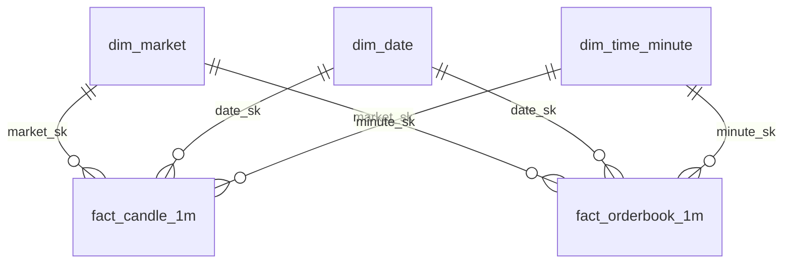

# 04. 데이터 명세서

이 문서는 **어떤 데이터가 어떤 모양으로 들어오고, 각 계층에서 어떤 테이블·컬럼이 되는지**를 정의합니다. 원천 필드는 2026-11-24에 실제로 받은 응답을 기준으로 적었습니다. 결정의 현재 상태는 [09_결정현황.md](09_결정현황.md)가 기준이고, 이 문서와 다르면 09가 우선합니다.

## 0. 공통 규칙

| 규칙 | 내용 |
|---|---|
| 시각 저장 | 모든 시각은 **UTC**로 저장. 화면에서만 KST로 변환 |
| 시각 컬럼 이름 | `event_at` = 업비트에서 사건이 일어난 시각, `sent_at` = 업비트가 메시지를 보낸 시각, `received_at` = 우리 Producer가 받은 시각, `ingested_at` = Bronze에 저장된 시각 |
| 가격·수량 타입 | `DECIMAL`. JSON 숫자 텍스트에서 바로 변환하고 float을 거치지 않음 (합계 오차 방지) |
| 마켓 키 | 원천의 `code` / `market` 값을 `market` 컬럼으로 통일 (예: `KRW-BTC`) |
| 테이블 이름 | `<계층>_<대상>` (예: `silver_trade`, `fact_candle_1m`) |
| 파티션 | 날짜(`event_date`, UTC) 기준. 시간 단위 파티션은 Bronze만 |

---

## 1. 원천 데이터 (업비트)

### 1.1 체결 `trade` (WebSocket)
거래가 한 건 성사될 때마다 메시지 1개.

| 필드 | 예시 | 의미 | 사용 |
|---|---|---|---|
| `type` | `trade` | 메시지 종류 | 라우팅 |
| `code` | `KRW-BTC` | 마켓 | 키 |
| `trade_timestamp` | `1795486668974` | 체결 시각 (epoch ms) | `event_at` |
| `timestamp` | `1795486669006` | 메시지 전송 시각 (epoch ms) | `sent_at` |
| `trade_date`, `trade_time` | `2026-11-24`, `02:17:48` | 체결 날짜·시각 (UTC 문자열) | 검증용 |
| `trade_price` | `82971000.0` | 체결 가격 (원) | 핵심 |
| `trade_volume` | `6.681e-05` | 체결 수량 | 핵심 |
| `ask_bid` | `BID` | 매수 주도(`BID`) / 매도 주도(`ASK`) | 핵심 |
| `sequential_id` | `17954866689740000` | 체결 고유 번호 | **중복 제거 키** · **정수(64비트)로만 읽기**: 값이 2^53을 넘어 실수(double)나 JavaScript 숫자로 읽으면 끝자리가 바뀜(계산). Spark 스키마는 `LongType`/`BIGINT` |
| `prev_closing_price` | `83726000.0` | 전일 종가 | 보조 |
| `change`, `change_price` | `FALL`, `755000.0` | 전일 대비 방향·금액 | 보조 |
| `best_ask_price`, `best_ask_size` | `82971000`, `0.0999` | 체결 시점 최우선 매도 호가 | 보조 |
| `best_bid_price`, `best_bid_size` | `82965000`, `0.0006` | 체결 시점 최우선 매수 호가 | 보조 |
| `stream_type` | `SNAPSHOT` / `REALTIME` | 연결 직후 첫 메시지는 `SNAPSHOT`(직전 체결 재전송) | 중복 원인 추적 |

### 1.2 호가 `orderbook` (WebSocket)
| 필드 | 예시 | 의미 |
|---|---|---|
| `code` | `KRW-BTC` | 마켓 |
| `timestamp` | `1795486668632` | 호가 시각 (epoch ms) → `event_at` |
| `total_ask_size` | `2.72711513` | 매도 대기 총량 |
| `total_bid_size` | `9.04529823` | 매수 대기 총량 |
| `orderbook_units[]` | 배열 | 가격 단계별 `ask_price`, `ask_size`, `bid_price`, `bid_size` |
| `level` | `0` | 호가 모아보기 단위 (0 = 기본) |
| `stream_type` | `SNAPSHOT` / `REALTIME` | |

호가 단계 수는 **30단계**로 확인했습니다(2026-11-24, 상위 10개 마켓 2분 측정). 메시지 평균 약 2.7KB(KRW-BTC 2,781B 실측)이고, KRW 전체 기준 Bronze 하루 약 12.2GB 중 약 11.8GB(약 97%, 계산)를 차지합니다. 호가에는 체결 번호 같은 고유 키가 없으므로 `(market, event_at)`을 키로 씁니다.

### 1.3 현재가 `ticker` (WebSocket)
주요 필드만 씁니다: `code`, `trade_price`, `opening_price`, `high_price`, `low_price`, `signed_change_rate`, `acc_trade_volume_24h`, `acc_trade_price_24h`, `market_state`, `market_warning`, `is_trading_suspended`, `delisting_date`, `timestamp`. 피처의 직접 입력보다는 **마켓 상태 확인과 교차 검증**에 씁니다. 거래 정지와 상장 폐지 예정일은 현재가에만 있습니다. KRW 전체 기준 초당 35.7건, 평균 966B (2026-11-25, 60초 실측).

### 1.4 마켓 목록 (REST `GET /v1/market/all?is_details=true`)
| 필드 | 예시 | 의미 |
|---|---|---|
| `market` | `KRW-BTC` | 마켓 |
| `korean_name`, `english_name` | `비트코인`, `Bitcoin` | 이름 |
| `market_event.warning` | `false` | 유의 종목 여부 |
| `market_event.caution.PRICE_FLUCTUATIONS` 등 5개 | `false` | 주의 표시 ([02 문서 6절](02_주제_문제정의.md)) |

Market Poller가 5분마다 호출해 Kafka에 넣습니다. 2026-11-24 기준 전체 887개, KRW 마켓 300개.

### 1.5 1분 캔들 (REST `GET /v1/candles/minutes/1`)
| 필드 | 의미 |
|---|---|
| `market` | 마켓 |
| `candle_date_time_utc`, `candle_date_time_kst` | 캔들 시작 시각 |
| `opening_price`, `high_price`, `low_price`, `trade_price` | 시가, 고가, 저가, 종가 |
| `candle_acc_trade_volume` | 거래량 |
| `candle_acc_trade_price` | 거래대금 |
| `timestamp` | 마지막 체결 시각 |

**용도는 두 가지**입니다. (1) 직접 만든 캔들과 비교하는 **대사 기준**, (2) 수집 공백 구간의 **1분 단위 백필**.

---

## 2. Kafka 메시지

Producer는 원본을 고치지 않고 **봉투(envelope)**에 담아 보냅니다.

```json
{
  "source": "upbit_ws",
  "msg_type": "trade",
  "market": "KRW-BTC",
  "producer_id": "producer-a",
  "connection_id": "c-20261124-0001",
  "received_at_ms": 1795486669120,
  "payload": { ...업비트 원본 그대로... }
}
```

| 필드 | 이유 |
|---|---|
| `source` | `upbit_ws`(WebSocket 실시간) / `upbit_rest`(REST로 받은 것: 끊긴 구간 체결 보충, 마켓 목록). `upbit_ws`의 `payload`는 받은 바이트 그대로, `upbit_rest`는 응답 배열의 한 항목을 JSON으로 다시 쓴 것 |
| `producer_id` | 어느 수집기가 보냈는지 구분 (지금은 1대, [09 문서 D7](09_결정현황.md)) |
| `connection_id` | 재연결 단위 추적. `SNAPSHOT` 중복이 어느 재연결에서 생겼는지 확인 |
| `received_at_ms` | 업비트 전송 시각과의 차이로 수집 지연 측정 |

| 토픽 | 키 | 내용 |
|---|---|---|
| `upbit.trade.raw` | market | 체결 |
| `upbit.orderbook.raw` | market | 호가 |
| `upbit.ticker.raw` | market | 현재가 |
| `upbit.market.raw` | market | 마켓 목록 (5분마다, 마켓별 1건) |
| `ops.ingest_gap` | producer_id | 연결 끊김·재연결 기록 |
| `gold.candle_1m` | market | 확정된 1분 캔들 (예측 서비스 입력) |
| `predictions.vol_5m` | market | 예측 결과 |

파티션 수: `upbit.trade.raw`, `upbit.orderbook.raw`, `upbit.ticker.raw`는 3, `upbit.market.raw`, `ops.ingest_gap`은 1 ([09 문서 2절](09_결정현황.md)). `gold.candle_1m`, `predictions.vol_5m`은 해당 단계에서 정합니다.

---

## 3. Bronze

**원본 그대로 보관. 추가만 허용.**

`bronze_trade_raw`, `bronze_orderbook_raw`, `bronze_ticker_raw`, `bronze_market_raw` 모두 같은 구조입니다.

| 컬럼 | 타입 | 설명 |
|---|---|---|
| `value_json` | STRING | Kafka 메시지 본문 (봉투 포함) 원문 |
| `kafka_topic` | STRING | |
| `kafka_partition` | INT | |
| `kafka_offset` | BIGINT | `(topic, partition, offset)`은 Kafka 안에서 유일 |
| `kafka_ts` | TIMESTAMP | Kafka 기록 시각 |
| `ingested_at` | TIMESTAMP | Bronze 저장 시각 |
| `ingest_date` | DATE | 파티션 |
| `ingest_hour` | INT | 파티션 |

추가 테이블:

| 테이블 | 내용 |
|---|---|
| `bronze_candle_rest` | REST 1분 캔들 원문 (대사·백필용) |
| `bronze_ingest_gap` | 수집 끊김 기록 원문 |

---

## 4. Silver

**형식을 맞추고, 중복을 없애고, 불량을 격리한 "정리된 사실".**

### 4.1 `silver_trade` — 한 행 = 체결 1건
| 컬럼 | 타입 | 설명 |
|---|---|---|
| `market` | STRING | PK |
| `sequential_id` | BIGINT | PK. 중복 제거 키 |
| `event_at` | TIMESTAMP | 체결 시각 (`trade_timestamp`) |
| `sent_at` | TIMESTAMP | 업비트 전송 시각 |
| `received_at` | TIMESTAMP | Producer 수신 시각 |
| `price` | DECIMAL(24,8) | |
| `volume` | DECIMAL(28,12) | |
| `notional` | DECIMAL(36,12) | `price × volume` (거래대금) |
| `side` | STRING | `BID` / `ASK` |
| `best_ask_price`, `best_bid_price` | DECIMAL(24,8) | |
| `stream_type` | STRING | `SNAPSHOT` / `REALTIME` / `REST` (REST 보충분) |
| `producer_id` | STRING | 처음 받은 수집기 |
| `first_kafka_offset` | STRING | 처음 저장된 `topic:partition:offset` (계보 추적) |
| `event_date` | DATE | 파티션 |

**중복 제거**: `foreachBatch` 안에서 Delta `MERGE ... ON market, sequential_id WHEN NOT MATCHED THEN INSERT`. 같은 체결이 두 번 와도 1행만 남습니다. 성능을 위해 `MERGE` 조건에 `event_date`를 함께 넣어 최근 파티션만 비교합니다. REST 보충분도 같은 `MERGE`로 들어가므로, WebSocket으로 이미 받은 체결은 다시 들어가지 않고 빠진 체결만 채워집니다.

### 4.2 `silver_orderbook` — 한 행 = 호가 메시지 1건
호가 메시지 1개(30줄)를 1행으로 요약합니다(구간 요약, D안). Bronze와 행 수가 같고, 30줄을 행으로 펼치지 않습니다.

| 컬럼 | 타입 | 설명 |
|---|---|---|
| `market` | STRING | PK |
| `event_at` | TIMESTAMP | PK |
| `received_at` | TIMESTAMP | |
| `total_ask_size`, `total_bid_size` | DECIMAL(28,12) | 원천 값 |
| `best_ask_price`, `best_bid_price` | DECIMAL(24,8) | 1줄 가격 |
| `ask_size_l1`, `bid_size_l1` | DECIMAL(28,12) | 1줄 수량 |
| `ask_size_l1_5`, `bid_size_l1_5` | DECIMAL(36,12) | 1~5줄 수량 합 |
| `ask_size_l6_10`, `bid_size_l6_10` | DECIMAL(36,12) | 6~10줄 수량 합 |
| `ask_size_l11_20`, `bid_size_l11_20` | DECIMAL(36,12) | 11~20줄 수량 합 |
| `ask_size_l21_30`, `bid_size_l21_30` | DECIMAL(36,12) | 21~30줄 수량 합 |
| `spread_bps` | DOUBLE | `(best_ask − best_bid) / mid × 10000` |
| `imbalance_30` | DOUBLE | `(bid 30줄 합 − ask 30줄 합) / (bid + ask)`, −1~1 |
| `ask_width_bps`, `bid_width_bps` | DOUBLE | 1줄 가격에서 30줄 가격까지의 폭 ÷ mid × 10000 |
| `ask_max_level`, `bid_max_level` | INT | 수량이 가장 큰 줄의 위치 (1~30) |
| `ask_max_size`, `bid_max_size` | DECIMAL(28,12) | 그 줄의 수량 |
| `n_levels` | INT | 받은 줄 수 (30이 아니면 품질 경보) |
| `event_date` | DATE | 파티션 |

계산 예 (KRW-BTC 실제 메시지 1개, 2026-11-25): ask 1~5/6~10/11~20/21~30줄 합 1.879 / 0.947 / 2.222 / 0.880, bid 0.274 / 0.043 / 0.353 / 0.406, 스프레드 5.94bps, `imbalance_30` −0.693, 폭 ask 9.4bps / bid 7.8bps, 가장 큰 ask 줄은 12번째 1.806 BTC.

**요약은 되돌릴 수 없습니다.** Silver로 30줄 원본을 복구할 수 없으므로, 요약 방식을 바꾸려면 Bronze 원본으로 다시 계산합니다. 2주 운영 동안 Bronze 호가 원본은 지우지 않습니다 ([09 문서 3·4절](09_결정현황.md)). 컬럼 이름은 구현 시 바뀔 수 있습니다.

### 4.3 `silver_market_status` — 한 행 = 마켓 × 폴링 시점
| 컬럼 | 타입 | 설명 |
|---|---|---|
| `market` | STRING | PK |
| `polled_at` | TIMESTAMP | PK |
| `korean_name`, `english_name` | STRING | |
| `is_warning` | BOOLEAN | `market_event.warning` |
| `caution_price_fluctuations` | BOOLEAN | |
| `caution_trading_volume_soaring` | BOOLEAN | |
| `caution_deposit_amount_soaring` | BOOLEAN | |
| `caution_global_price_differences` | BOOLEAN | |
| `caution_concentration_of_small_accounts` | BOOLEAN | |
| `status_hash` | STRING | 위 상태값의 해시. 변화 감지용 |

### 4.4 `silver_quarantine` — 불량 데이터 격리
| 컬럼 | 타입 | 설명 |
|---|---|---|
| `source_table` | STRING | 어느 Bronze에서 왔는지 |
| `kafka_ref` | STRING | `topic:partition:offset` |
| `reason_code` | STRING | `SCHEMA_INVALID`, `PRICE_NON_POSITIVE`, `VOLUME_NON_POSITIVE`, `TIMESTAMP_INVALID`, `UNKNOWN_MARKET` 등 |
| `raw_value` | STRING | 원문 |
| `quarantined_at` | TIMESTAMP | |

### 4.5 `silver_ingest_gap` — 수집 공백
| 컬럼 | 타입 | 설명 |
|---|---|---|
한 행 = 연결 하나가 비었던 구간 1개. 공백 처리 원칙은 [09 문서 2절 "연결 끊김"](09_결정현황.md).

| 컬럼 | 타입 | 설명 |
|---|---|---|
| `producer_id` | STRING | |
| `connection_id` | STRING | 끊긴 연결 |
| `msg_type` | STRING | `trade` / `orderbook` / `ticker` (종류별 연결이 따로라서) |
| `gap_start` | TIMESTAMP | 그 연결에서 마지막으로 정상 수신한 시각 |
| `gap_end` | TIMESTAMP | 다시 연결한 뒤 처음 받은 시각 |
| `reason` | STRING | `SILENCE`(침묵 감지로 우리가 끊음), `SERVER_CLOSE`(업비트가 종료 코드를 보내며 끊음), `CONN_LOST`(종료 코드 없이 연결이 끊김), `ERROR`(우리 코드 오류), `PROCESS_RESTART`, `PLANNED_STOP`, `FORCED`(시험용으로 일부러 끊음) |
| `close_code_rcvd`, `close_code_sent` | STRING | 받은·보낸 종료 코드와 이유 |
| `pong_ok` | BOOLEAN | 침묵 중에도 ping 응답이 왔는지. true면 데이터만 멈춘 것, false면 연결 전체가 멈춘 것 |
| `server_ip` | STRING | 붙어 있던 업비트 서버 주소 (같은 서버에서 반복되는지 확인) |
| `others_stalled` | INT | 같은 시각(±10초)에 함께 멈춘 다른 연결 수 |
| `probe_upbit_ok` | BOOLEAN | 침묵을 감지한 순간 업비트 REST가 응답했는지 |
| `probe_external_ok` | BOOLEAN | 같은 순간 업비트가 아닌 외부 주소(시계 확인에 쓰는 `time.google.com`)가 응답했는지 |
| `fault_side` | STRING | `UPBIT`(업비트 쪽) / `LOCAL`(우리 쪽) / `UNKNOWN` — 아래 판정표로 정함 |
| `recoverable` | BOOLEAN | 체결은 true(REST 체결 이력), 호가·현재가는 false |
| `backfilled_trades` | INT | REST로 채운 체결 수 (체결만, 나머지는 null) |

**누구 쪽 끊김인지 판정** (수집기가 끊김마다 바로 판정해 `fault_side`에 남김)

| 판정 | 근거 (하나라도 맞으면) |
|---|---|
| `LOCAL` 우리 쪽 | 외부 주소도 응답 없음(`probe_external_ok = false`) · 프로세스 재시작·PC 절전·계획 정지 · 우리 쪽에서 오류가 나서 끊음 |
| `UPBIT` 업비트 쪽 | 외부 주소는 정상인데 업비트가 종료 코드를 보내며 끊음 · ping 응답은 오는데 데이터만 멈춤(`pong_ok = true`) · 외부 주소는 정상인데 업비트 응답만 없음 · 여러 연결이 시차를 두고 차례로 멈춤(물결) |
| `UNKNOWN` | 위 어디에도 해당하지 않음. 2주 기록에서 `UNKNOWN` 비율을 따로 봄 |

수집기가 1대이므로([09 문서 D7](09_결정현황.md)) **연결 공백이 곧 실제 공백**입니다. 연결이 살아 있는데 어떤 종목에 메시지가 없는 것은 거래가 없었던 것이라 공백으로 기록하지 않습니다.

---

## 5. Gold — 분석용 스타 스키마



### 5.1 `fact_candle_1m` — 한 행 = 마켓 × 1분
| 컬럼 | 타입 | 설명 |
|---|---|---|
| `market_sk` | INT | FK → dim_market (해당 시각에 유효했던 행) |
| `market` | STRING | 편의상 함께 저장 |
| `minute_start` | TIMESTAMP | PK (UTC, 1분 구간 시작) |
| `date_sk`, `minute_sk` | INT | FK |
| `open`, `high`, `low`, `close` | DECIMAL(24,8) | 체결 시각 순서 기준 (같은 시각이면 `sequential_id` 순) |
| `volume` | DECIMAL(28,12) | |
| `notional` | DECIMAL(36,12) | 거래대금 |
| `buy_volume`, `sell_volume` | DECIMAL(28,12) | `side`별 거래량 (공식 캔들에 없는 정보) |
| `trade_count` | INT | 체결 건수 (공식 캔들에 없는 정보) |
| `vwap` | DECIMAL(24,8) | `notional / volume` |
| `is_filled` | BOOLEAN | 체결이 없어서 직전 종가로 채운 분 |
| `has_gap` | BOOLEAN | 수집 공백이 걸친 분 |
| `revision` | INT | 일일 재계산으로 값이 바뀔 때마다 증가 (0 = 실시간 확정값) |
| `computed_by` | STRING | `stream` / `daily_recompute` / `rest_backfill` |
| `event_date` | DATE | 파티션 |

### 5.2 `fact_orderbook_1m` — 한 행 = 마켓 × 1분
| 컬럼 | 타입 | 설명 |
|---|---|---|
| `market_sk`, `market`, `minute_start`, `date_sk`, `minute_sk` | | 위와 같음 |
| (아래 컬럼은 초안) | | 메시지별 요약을 1분으로 묶는 방식(마지막 값 또는 평균)은 미정 ([09 문서 11절](09_결정현황.md)) |
| `spread_bps_avg` | DOUBLE | 1분 평균 스프레드 |
| `spread_bps_max` | DOUBLE | |
| `imbalance_close` | DOUBLE | 1분 마지막 스냅샷의 호가 불균형 |
| `imbalance_avg` | DOUBLE | |
| `bid_size_l1_5_close`, `ask_size_l1_5_close` | DECIMAL(36,12) | 1분 마지막 메시지의 1~5줄 합 |
| `snapshot_count` | INT | 1분 동안 받은 호가 스냅샷 수 |

### 5.3 `dim_market` — SCD Type 2, 한 행 = 마켓 × 상태 유효 기간
| 컬럼 | 타입 | 설명 |
|---|---|---|
| `market_sk` | INT | PK (대리 키) |
| `market` | STRING | 자연 키 |
| `base_asset`, `quote_currency` | STRING | `BTC`, `KRW` |
| `korean_name`, `english_name` | STRING | |
| `is_warning` | BOOLEAN | |
| `caution_flags` | ARRAY<STRING> | 켜진 주의 표시 목록 |
| `valid_from`, `valid_to` | TIMESTAMP | `valid_to`가 null이면 현재 |
| `is_current` | BOOLEAN | |

`silver_market_status`의 `status_hash`가 바뀔 때만 새 행을 추가합니다. 예측 대상은 KRW 전체이므로 대상 여부 컬럼은 두지 않습니다. 유니버스(대표 성적표 대상) 여부는 ML 단계에서 일별로 계산합니다.

### 5.4 `dim_date`, `dim_time_minute`
| 테이블 | 컬럼 |
|---|---|
| `dim_date` | `date_sk`, `date_kst`, `day_of_week`, `is_weekend`, `year`, `month`, `day` |
| `dim_time_minute` | `minute_sk` (0~1439), `hour_kst`, `minute_of_hour`, `time_bucket` (`새벽`/`오전`/`오후`/`저녁`) |

`minute_start`(UTC)를 KST로 바꾼 값 기준으로 연결합니다.

### 5.5 대사 테이블
| 테이블 | 한 행 | 주요 컬럼 |
|---|---|---|
| `ref_candle_official` | 마켓 × 1분 | 업비트 공식 OHLCV |
| `recon_candle_1m` | 마켓 × 1분 | `match_open`, `match_high`, `match_low`, `match_close`, `volume_diff`, `is_match` |
| `recon_hourly` | 마켓 × 1시간 | `minutes_official`, `minutes_matched`, `match_rate`, `minutes_missing`(공식에는 있고 우리에게 없음 = 유실), `minutes_no_trade`(공식도 없음 = 거래 없음) |
| `recon_daily_summary` | 날짜 × 마켓 | `minutes_total`, `minutes_matched`, `match_rate`, `minutes_with_gap`, `min_hourly_match_rate`(그날 시간 칸 중 최소 일치율) |

거래가 없어 공식 캔들도 없는 분은 유실로 세지 않습니다. 일치율은 공식 캔들이 있는 분만 분모로 씁니다 ([09 문서 9-2절](09_결정현황.md) E).

---

## 6. Gold — ML용

자세한 피처·라벨 정의는 [05_ML_MLOps설계.md](05_ML_MLOps설계.md)에 있습니다.

### 6.1 `feat_market_1m` — 한 행 = 마켓 × 1분 (넓은 표)
| 컬럼 | 설명 |
|---|---|
| `market`, `minute_start` | PK |
| 피처 컬럼들 | `ret_1m`, `ret_5m`, `ret_15m`, `rv_15m`, `range_1m`, `vol_ratio_60`, `trade_count_ratio_60`, `buy_ratio_1m`, `buy_ratio_5m`, `spread_bps_avg`, `imbalance_close`, `hour_kst`, `is_weekend` |
| `feature_version` | 피처 정의 버전 (예: `v1`) |
| `ob_age_sec` | 그 분이 끝나는 시점까지 받은 마지막 호가가 몇 초 전 것인지 |
| `ob_missing` | 마지막 호가가 너무 오래됐거나 그 사이에 호가 연결 공백이 있으면 true. 이때 호가 피처(`spread_bps_avg`, `imbalance_close`)는 null. "너무 오래됨" 기준은 ML 단계에서 정함 |
| `is_valid` | 계산에 필요한 과거 60분이 모두 있고 공백이 없으면 true |

**호가는 과거 방향으로만 붙입니다**: 각 분에는 그 분이 끝나기 전에 받은 마지막 호가만 씁니다. 나중에 받은 호가로 과거를 채우면 실제 예측 때는 없던 정보를 모델이 보게 됩니다.

### 6.2 `label_vol_5m` — 한 행 = 마켓 × 1분
| 컬럼 | 설명 |
|---|---|
| `market`, `minute_start` | PK |
| `future_range` | 다음 5분 변동폭 |
| `label` | 0 / 1 / null (공백이 걸치거나 유효 구간이 아니면 null) |
| `threshold_version` | 임계값을 계산한 학습셋 버전 |
| `label_ready_at` | 라벨을 계산할 수 있게 된 시각 (`minute_start + 6분 + watermark`) |

### 6.3 `train_dataset` 스냅샷
`feat_market_1m`과 `label_vol_5m`을 조인하고 `split` 컬럼(`train`/`val`/`test`)을 붙인 넓은 표입니다. 스냅샷마다 manifest를 남깁니다.

```json
{
  "dataset_version": "ds-20261210-01",
  "period": ["2026-11-25T00:00Z", "2026-12-09T00:00Z"],
  "markets": ["KRW-BTC", "..."],
  "feature_version": "v1",
  "label_rule": "future_range_5m >= p80(train, per market)",
  "thresholds": {"KRW-BTC": 0.0031, "...": "..."},
  "split": {"train": "...", "val": "...", "test": "...", "embargo_minutes": 10},
  "source_versions": {"fact_candle_1m": 412, "fact_orderbook_1m": 398},
  "row_counts": {"train": 0, "val": 0, "test": 0},
  "positive_rate": {"train": 0.2, "val": null, "test": null},
  "content_hash": "sha256:..."
}
```

위 값은 형식 예시이며 실제 값이 아닙니다. `source_versions`는 Delta 테이블 버전 번호라서, 같은 버전으로 다시 읽으면 같은 학습셋이 나옵니다.

### 6.4 예측·채점
| 테이블 | 한 행 | 주요 컬럼 |
|---|---|---|
| `prediction_vol_5m` | 마켓 × 1분 × 모델 버전 | `p_spike`, `model_version`, `feature_version`, `features_json`(예측에 쓴 피처 값), `predicted_at`, `latency_ms` |
| `prediction_scored` | 마켓 × 1분 × 모델 버전 | `p_spike`, `label`, `future_range`, `scored_at` |
| `model_metrics_online` | 모델 버전 × 1시간 | `pr_auc`, `brier`, `precision_at_alert`, `recall_at_alert`, `n_scored`, `positive_rate` |

---

## 7. PostgreSQL (대시보드용)

| 테이블 | 원본 | 보관 |
|---|---|---|
| `serve_candle_1m` | `fact_candle_1m` | 30일 |
| `serve_orderbook_1m` | `fact_orderbook_1m` | 30일 |
| `serve_prediction` | `prediction_vol_5m` | 30일 |
| `serve_prediction_scored` | `prediction_scored` | 30일 |
| `serve_model_metrics` | `model_metrics_online` | 전체 |
| `serve_recon_daily` | `recon_daily_summary` | 전체 |
| `serve_market_current` | `dim_market` (현재 행) | 최신만 |

모두 Spark `foreachBatch`에서 기본 키 기준 upsert합니다. 같은 배치를 다시 보내도 결과가 같습니다.

- DE 단계(2주 운영)에 필요한 것은 `serve_candle_1m`, `serve_orderbook_1m`, `serve_market_current`, `serve_recon_daily` 4개입니다. 예측·채점·모델 테이블은 ML 단계에서 만듭니다.
- 30일 보관은 초안이며 근거가 없습니다(미정). 원본·정제·학습 데이터는 Delta에 있고, PostgreSQL은 화면용 복사본입니다.

---

## 8. 데이터 품질 규칙

| 계층 | 규칙 | 실패 시 |
|---|---|---|
| Silver | 필수 컬럼 null 없음, `price > 0`, `volume > 0`, `side ∈ {BID, ASK}`, `event_at`이 수신 시각보다 10분 이상 앞서지 않음 | 해당 행 격리 |
| Silver | `(market, sequential_id)` 중복 0건 | 경보 |
| Silver | `received_at − sent_at` p95 | 지표로 기록, 기준 초과 시 경보 |
| Gold | KRW 전체 마켓의 1분 캔들 연속성 (빠진 분 = 공백 또는 `is_filled`로 설명되어야 함) | 경보 |
| Gold | 공식 캔들 일치율 | 일일 보고, 기준 미달 시 경보 |
| Gold | 일일 재계산으로 바뀐 행 수 (`revision` 증가 수) | 지표로 기록 |
| ML | 피처 범위 검사 (예: `buy_ratio ∈ [0,1]`), `is_valid` 비율 | 학습셋 생성 중단 |
| ML | 라벨 양성 비율이 학습 기간 대비 크게 다름 | 경고 기록 |
