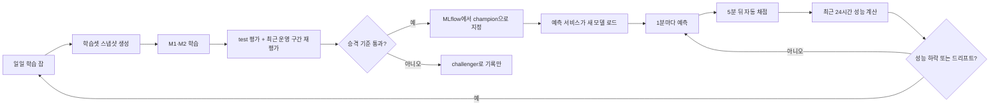

# 05. ML · MLOps 설계

문제 정의(무엇을 예측하고 어떻게 평가하는지)는 [02_주제_문제정의.md](02_주제_문제정의.md)에 있습니다. 이 문서는 **피처, 학습셋, 모델, 운영 흐름**을 정의합니다.

> 결정의 현재 상태는 [09_결정현황.md](09_결정현황.md)가 기준입니다. 프로젝트는 2주 실시간 운영 뒤 **그 2주 데이터로 예측이 되는지 확인하고 종료**합니다. 그래서 이 문서의 학습 기간, 재학습(6절), 서빙 범위는 ML 단계 시작 전에 2주 데이터 기준으로 다시 검토합니다. 그 전까지 DE 구현에는 반영하지 않습니다.

## 1. 기대치: 무엇을 기대하고 무엇을 기대하지 않는가

| 질문 | 답 |
|---|---|
| 데이터가 쌓이고 계속 재학습하면 정확도가 계속 오르나? | **아니오.** 시장은 패턴이 계속 바뀌고(비정상성), 단기 가격 움직임은 원래 예측이 어렵습니다. 어느 수준에서 오르내리며 유지되는 것이 정상입니다. 재학습의 목적은 "계속 오르게"가 아니라 "**시장이 바뀌어도 성능이 무너지지 않게**"입니다. |
| 그럼 예측이 의미가 있나? | **방향(오를지 내릴지)보다 변동성(변동 폭의 크기)이 더 예측 가능한 편**이라서 이 문제를 골랐습니다. 변동성은 몰려서 나타나는 경향(최근에 크게 움직였으면 곧 또 크게 움직이기 쉬움)이 알려져 있습니다. 다만 이 데이터에서 실제로 얼마나 되는지는 5단계에서 확인합니다. |
| 정답을 베낄 위험(누수)은? | **설계로 막습니다.** 아래 4절 참고. 누수가 있으면 오프라인 성능은 비정상적으로 높고 운영 성능은 낮게 나오므로, 그 차이 자체를 누수 감지 신호로 씁니다. |
| 성능이 기준선과 비슷하면? | 실패가 아닙니다. "규칙으로 충분했다"를 근거와 함께 보고합니다. 이 프로젝트의 핵심 증거는 파이프라인과 운영 흐름입니다. |

## 2. 피처 (`feature_version = v1`)

모든 피처는 **시각 `t`의 1분 구간이 끝난 시점까지의 데이터만** 사용합니다.

| 피처 | 정의 | 직관 |
|---|---|---|
| `ret_1m`, `ret_5m`, `ret_15m` | `ln(close[t] / close[t−k])` | 최근 가격 흐름 |
| `rv_15m` | 최근 15개 1분 로그 수익률의 표준편차 | 최근 변동성 (변동성은 몰려 다님) |
| `range_1m` | `(high[t] − low[t]) / close[t]` | 현재 분의 변동 폭 |
| `vol_ratio_60` | `volume[t] / 평균(volume[t−60..t−1])` | 거래량 급증 |
| `trade_count_ratio_60` | `trade_count[t] / 평균(trade_count[t−60..t−1])` | 체결 빈도 급증 |
| `buy_ratio_1m`, `buy_ratio_5m` | `buy_volume / volume` (1분, 5분) | 매수 쏠림 |
| `spread_bps_avg` | 1분 평균 스프레드 | 유동성이 얇아짐 |
| `imbalance_close` | 1분 마지막 호가 불균형 | 대기 주문의 쏠림 |
| `hour_kst`, `is_weekend` | 시간대, 주말 | 시간대별 패턴 |
| `btc_ret_1m`, `btc_rv_15m` | KRW-BTC의 `ret_1m`, `rv_15m` | 알트코인은 BTC를 따라 움직이는 경향 |
| `mkt_rv_15m` | 같은 분에 유효한 KRW 마켓 `rv_15m`의 중앙값 | 시장 전체 변동성 수준 |
| `corr_btc_60` | 최근 60분 1분 수익률의 BTC와의 상관계수 | 이 코인이 지금 BTC와 얼마나 같이 움직이나 |

- 마지막 네 줄은 **마켓 간 관계 피처**입니다. 같은 시각 `t`까지의 다른 마켓 데이터만 쓰므로 누수 규칙은 같습니다. 다른 마켓의 캔들이 아직 확정되지 않았으면 그 분은 `is_valid = false`로 둡니다. 효과가 있는지는 5.1절 Ablation(A2)으로 확인합니다. (도입 배경: [ADR-14](08_결정기록_ADR.md))

- 과거 60분이 모두 있어야 `is_valid = true`입니다. 공백이 걸치면 학습과 예측에서 제외합니다.
- 피처 계산은 **Python 함수 하나**(`features/v1.py`)로 만들고 학습(Spark `applyInPandas`)과 예측 서비스(pandas)가 같이 씁니다.
- 피처를 바꾸면 `feature_version`을 올리고, 이전 버전은 그대로 둡니다.

## 3. 학습셋

| 항목 | 규칙 |
|---|---|
| 기간 | 미정. 비교 실험으로 정함 ([09 문서 6절](09_결정현황.md)). 실시간 데이터는 2주뿐이므로 ML 단계에서 다시 검토 |
| 분할 | 시간순: train 70% → val 15% → test 15% |
| 간격 (embargo) | 각 경계 앞뒤로 10분 제외 (라벨 기간 5분 + 피처 겹침 여유) |
| 임계값 `θ_market` | **train 구간의 유효 구간만으로** 마켓별 80번째 백분위수 계산, manifest에 기록 |
| 제외 | `is_valid = false`, `label = null` (유효 구간이 아닌 분 포함) |
| 버전 | 스냅샷마다 `dataset_version`과 manifest ([04 문서 6.3절](04_데이터명세서.md)) |

## 4. 데이터 누수 방지

데이터 누수는 **학습 입력에 예측 시점 이후의 정보가 섞이는 것**입니다. 이 프로젝트에서 생길 수 있는 경로와 막는 방법입니다.

| 누수 경로 | 예 | 막는 방법 | 검사 |
|---|---|---|---|
| 피처에 미래 데이터 | 집계 창에 `t+1`분이 섞임 | 모든 창은 `t` 이전 방향으로만 | 단위 테스트: 미래 데이터를 바꿔도 피처 값이 그대로인지 확인 |
| 라벨이 피처로 들어감 | `future_range`가 학습 입력에 포함 | 라벨은 별도 테이블, 학습 직전에만 조인. 입력 컬럼 목록을 명시적으로 고정 | 학습 코드가 허용 목록 외 컬럼을 거부 |
| 임계값 누수 | test 기간 분포로 임계값 계산 | train 구간만으로 계산 | manifest에 계산 구간 기록 |
| 분할 경계 겹침 | train 마지막 분의 라벨이 val 첫 분과 겹침 | embargo 10분 | 분할 코드 테스트 |
| 무작위 분할 | 시계열을 섞어서 나눔 | 시간순 분할만 허용 | |
| 재계산 값으로 학습, 실시간 값으로 예측 | 학습은 일일 재계산 후 값, 운영은 실시간 확정값 | 운영 중 예측에 쓴 피처 값을 저장해 두고 배치 재계산 값과 비교 | 차이 비율을 지표로 기록 |
| 운영 데이터 재사용 | 이미 채점한 운영 구간을 test로 다시 씀 | test는 항상 학습 시점 이후 구간 | |

**최종 확인 방법.** 오프라인 test 성능과 운영 중 자동 채점 성능을 나란히 기록합니다. 오프라인이 운영보다 크게 높으면 누수나 과적합을 의심하고 원인을 찾습니다.

## 5. 모델

| 이름 | 내용 |
|---|---|
| B0 | 항상 0 |
| B1 | `vol_ratio_60 ≥ k`이면 1 (k는 val에서 선택) |
| M1 | 로지스틱 회귀 (표준화 후, 클래스 가중치 균형) |
| M2 | LightGBM (클래스 불균형 보정, early stopping은 val 기준). 트리 모델이라 표준화 불필요 ([09 문서 M6](09_결정현황.md)) |

- 모든 코인이 모델 1개를 공유합니다(제안). 그래서 코인 간 단위 맞추기(수익률·변동폭 %, 거래량은 그 코인 평균 대비 배수, 호가는 비율)가 필수입니다 ([09 문서 9절](09_결정현황.md)).

- 하이퍼파라미터 탐색은 작게 시작합니다. 처음부터 넓게 탐색하면 val에 과적합됩니다.
- 모든 학습은 MLflow run으로 기록합니다: `dataset_version`, `feature_version`, 파라미터, 지표, 피처 중요도, 모델 파일.

**왜 LightGBM으로 시작하나.** 피처를 행으로 펼친 표 데이터에서 성능이 안정적이고, CPU로 수십만 행을 수 초~수 분에 학습해 매일 재학습에 부담이 없으며, 2주 정도의 데이터에서도 딥러닝보다 과적합 위험이 작습니다. 피처 중요도로 결과를 설명할 수도 있습니다. 고정된 선택은 아니며, 아래 비교 후보보다 못하면 바꿉니다.

### 5.1 오프라인 평가 방법

한 번 나눠서 한 번 평가하고 끝내지 않습니다. 아래 세 가지를 같이 씁니다.

**Walk-forward 검증.** 운영에서 매일 하는 재학습을 과거 데이터로 미리 재현합니다.

```
1회차: 1~14일 학습 → 15일 평가
2회차: 2~15일 학습 → 16일 평가
3회차: 3~16일 학습 → 17일 평가 ...
```

- 회차마다 `θ_market`도 그 회차의 train 구간으로 다시 계산합니다.
- 결과는 "평균 PR-AUC ± 회차별 편차"로 보고합니다. 편차가 크면 날마다 성능이 들쭉날쭉하다는 뜻입니다.
- 6단계 운영 채점 결과와 나란히 비교합니다. 오프라인이 운영보다 크게 높으면 누수나 과적합을 의심합니다.

**Ablation (피처 묶음 켜고 끄기).** "이 데이터가 정말 예측에 도움이 됐나?"를 확인합니다. 모델은 M2로 고정하고 Walk-forward로 평가합니다.

| 실험 | 빼는 피처 | 확인하는 질문 |
|---|---|---|
| A0 | 없음 (전체) | 기준 |
| A1 | 호가 피처 (`spread_bps_avg`, `imbalance_close`) | 수집 용량의 약 97%를 차지하는 호가 데이터가 그만한 값을 하는가 |
| A2 | 마켓 간 피처 (`btc_*`, `mkt_rv_15m`, `corr_btc_60`) | 마켓 간 관계가 도움이 되는가 |
| A3 | 체결 방향 피처 (`buy_ratio_*`) | 매수·매도 구분이 도움이 되는가 |
| A4 | (확장 시) 뉴스 피처 v2 추가 | 8절 뉴스 확장의 효과 |

**확률 신뢰도 (calibration).** 예측 확률을 10개 구간으로 나눠 "예측 30% 구간에서 실제 급변동 비율도 30% 근처인가"를 그립니다(신뢰도 곡선). Brier score와 함께 기록하고, 크게 어긋나면 isotonic 보정을 검토합니다. 대시보드에 "위험도 70%"를 띄우려면 이 근거가 필요합니다.

### 5.2 추가 비교 후보 (선택)

| 이름 | 내용 | 조건 |
|---|---|---|
| B2 | HAR-RV: 최근 1·5·15분 변동성의 선형 결합으로 다음 5분 변동성을 예측한 뒤 `θ_market`과 비교 | 변동성 전용 고전 모델보다 나은지 확인. 결과를 "고변동 상태" 표시로 대시보드에도 씀 |
| M3 | 작은 GRU 또는 시계열 사전학습 모델(Chronos 등), GPU 사용 | 5단계 결과가 나온 뒤 여유가 있을 때. 사전학습 모델은 라이선스와 이 문제에 맞는지를 도입 시점에 확인 |

## 6. 운영 흐름 (MLOps 한 바퀴)

### 용어: 이 프로젝트는 "주기적 재학습(CT)"이다
| 개념 | 뜻 | 이 프로젝트 |
|---|---|---|
| **주기적 재학습 (CT, Continuous Training)** | 새 데이터가 쌓이면 재학습 → 검증 → 조건부 재배포. 배포 사이에는 모델 고정. "지속"은 모델이 이어진다는 뜻이 아니라 **이 과정이 자동으로 반복된다**는 뜻 | **채택** |
| 온라인 학습 (Online Learning) | 데이터가 들어올 때마다 가중치를 점진 갱신 | 미채택 ([ADR-09](08_결정기록_ADR.md)) |
| Continual Learning | 새 데이터·과제를 배우면서 이전 지식을 잊지 않게 하는 연구 분야 | 미채택 |

재학습은 **매번 처음부터** 합니다(기존 모델을 이어서 학습하지 않음). 학습셋 기간은 최근 N일 이동 창이므로, 오래된 시장 패턴은 자연스럽게 빠지고 최신 패턴이 반영됩니다. 이어서 학습하지 않는 이유와 비교 실험은 6.5절에 있습니다.

| CT 트리거 | 조건 |
|---|---|
| 정기 | 하루 1회 |
| 성능 하락 | 최근 24시간 운영 PR-AUC가 학습 시 test 대비 0.05 이상 낮음 |
| 피처 드리프트 | 주요 피처 PSI ≥ 0.2 |
| 라벨 분포 변화 | 실제 양성 비율이 학습 기간 대비 2배 이상 또는 절반 이하 |



### 6.1 모델 레지스트리
- MLflow 모델 레지스트리에 모델을 등록하고, 운영 모델은 별칭 `champion`, 후보는 `challenger`로 구분합니다.
- 예측 서비스는 시작할 때와 1분마다 `champion`이 바뀌었는지 확인하고, 바뀌었으면 새 모델을 불러옵니다.
- 문제가 생기면 이전 버전에 `champion`을 다시 지정하는 것으로 되돌립니다.

### 6.2 승격 기준
아래를 **모두** 만족할 때만 교체합니다. 값은 시작 값이며 운영하면서 조정합니다.
1. 새 모델의 test PR-AUC가 현재 champion보다 **0.01 이상** 높음
2. 최근 24시간 운영 구간을 다시 평가했을 때도 champion보다 낮지 않음
3. 마켓별 PR-AUC 중 champion보다 크게(0.05 이상) 떨어지는 마켓이 없음
4. 피처 범위 검사와 학습셋 품질 검사를 통과함

### 6.3 자동 채점
- 채점 잡이 1분마다 `label_ready_at`이 지난 예측을 찾아 정답과 조인하고 `prediction_scored`에 저장합니다.
- 1시간 단위로 `model_metrics_online`을 계산합니다: PR-AUC, Brier score, 알림 기준값에서의 정밀도·재현율, 채점 건수, 실제 양성 비율.

### 6.4 드리프트 감지
| 종류 | 방법 | 재학습 트리거 (시작 값) |
|---|---|---|
| 성능 드리프트 | 최근 24시간 운영 PR-AUC | 학습 시 test PR-AUC보다 0.05 이상 낮음 |
| 피처 드리프트 | 피처별 PSI (학습 분포 vs 최근 24시간) | 주요 피처 PSI ≥ 0.2 |
| 라벨 분포 변화 | 최근 24시간 실제 양성 비율 | 학습 기간 대비 2배 이상 또는 절반 이하 |

트리거가 없어도 하루 1회 정기 학습은 돌립니다. 트리거는 "정기 학습을 기다리지 않고 바로 돌린다"는 뜻입니다.

### 6.5 왜 이어서 학습하지 않나 (선택 비교 실험)

LightGBM은 `init_model`로 어제 모델에 오늘 데이터를 이어 붙여 학습할 수 있습니다. 구현은 쉽지만 이 문제에서는 부작용이 큽니다.

| 문제 | 설명 |
|---|---|
| 옛 패턴이 빠지지 않음 | 기존 트리는 그대로 두고 새 트리를 뒤에 추가하는 방식이라, 시장이 바뀐 뒤에도 옛 패턴이 모델에 남고 모델이 계속 커짐 |
| 정답 기준이 섞임 | `θ_market`이 학습 기간마다 달라서, 다른 기준으로 만든 정답이 한 모델에 섞임 |
| 추적·롤백이 어려움 | "v3 = v2 + 하루"처럼 이력이 사슬로 이어져, 중간에 오염된 데이터가 들어가면 이후 모델이 모두 영향을 받음 |
| 피처를 바꿀 수 없음 | 피처가 바뀌면 입력 모양이 달라져 결국 처음부터 학습해야 함 |
| 이득이 작음 | 처음부터 학습해도 수 초~수 분 |

말이 아니라 결과로 답하려면 6단계 이후 아래 비교를 같은 기간에 돌립니다(선택).

| 방식 | 내용 |
|---|---|
| A. 주기적 재학습 (메인) | 매일 최근 14일로 처음부터 |
| B. 이어서 학습 | 어제 모델 + 오늘 데이터 (`init_model`) |
| C. 이어서 학습 + 리플레이 | B에 과거 데이터 일부를 섞음 |

비교 항목: 운영 채점 PR-AUC, 과거 변동성이 컸던 날의 성능, 모델 크기, 학습 시간.

## 7. 화면

화면은 보는 사람에 따라 둘로 나눕니다. 둘 다 PostgreSQL의 `serve_*` 테이블을 기반으로 합니다. ([ADR-07](08_결정기록_ADR.md))

### 7.1 서비스 대시보드 (React 웹 + FastAPI)
코인별 급변동 위험도를 보여주는 사용자용 화면입니다. 새 예측이 나오면 새로고침 없이 바로 갱신됩니다.

| 화면 요소 | 데이터 경로 |
|---|---|
| 코인별 현재 위험도 (순위표, 실시간) | Kafka `predictions.vol_5m` → FastAPI WebSocket |
| 코인 상세: 1분 캔들 차트 + 위험도 추이 | REST `GET /markets/{code}/candles`, `GET /markets/{code}/predictions` ← `serve_candle_1m`, `serve_prediction` |
| 예측 vs 실제 결과 (채점 대기 구간 구분) | REST `GET /markets/{code}/scored` ← `serve_prediction_scored` |
| 업비트 주의 표시 | REST `GET /markets` ← `serve_market_current` |
| 현재 운영 모델 버전 | REST `GET /model` ← `serve_model_metrics` |

- API 응답 형식은 OpenAPI 문서(FastAPI 자동 생성)로 고정하고, 프론트엔드 타입은 그 스키마에서 생성합니다.
- WebSocket이 끊기면 웹은 재연결 후 REST로 빠진 구간을 다시 받습니다.
- 차트 라이브러리는 캔들 차트에 맞는 것을 구현 시점에 고릅니다(후보: TradingView Lightweight Charts, Apache ECharts).

### 7.2 운영 대시보드 (Grafana)
파이프라인과 모델이 정상인지 감시하는 운영자용 화면입니다.

| 패널 | 데이터 |
|---|---|
| 파이프라인 상태 | Prometheus: 수집 지연, Kafka 적체, 처리 지연, 격리 건수, 공백 |
| 정확성 | `serve_recon_daily`: 공식 캔들 일치율 |
| 모델 성적표 | `serve_model_metrics` (champion 버전, 최근 24시간 PR-AUC, 정밀도·재현율) |
| 재학습·교체 이력 | MLflow 기록을 `serve_model_metrics`에 함께 기록 |
| 확률 신뢰도 | `serve_prediction_scored`: 최근 7일 신뢰도 곡선 |
| 드리프트 | PSI, 양성 비율 추이 |

## 8. 확장: 뉴스·공지 데이터 추가

| 항목 | 내용 |
|---|---|
| 기대 효과 | 거래소 공지(상장·유의 지정 등)나 뉴스가 나온 직후 변동성이 커지는 경우를 잡을 가능성이 있음. 다만 **효과는 확인 전까지 알 수 없음** |
| 어려운 점 | (1) 공지·뉴스는 드물게 오므로 대부분의 분에는 영향이 없음 (2) 기사 게시 시각과 실제로 알려진 시각이 달라서 누수가 생기기 쉬움 (3) 수집 출처의 이용 조건 확인 필요 |
| 방식 | 뉴스 수집 → 텍스트를 숫자 피처로 변환 (예: "최근 30분 해당 코인 관련 기사 수", 로컬 LLM이나 임베딩 모델로 만든 감성 점수) → `feat_market_1m`에 컬럼 추가 (`feature_version = v2`) |
| 시점 규칙 | 피처에는 **우리 수집기가 그 기사를 받은 시각(`received_at`)** 이전 기사만 사용. 기사에 적힌 게시 시각만 믿으면 미래 정보가 섞일 수 있음 |
| 평가 | v1과 v2를 같은 기간·같은 분할로 비교. 개선이 없으면 v1 유지 |
| DE 측면 가치 | 성격이 전혀 다른 소스(드물게 오는 텍스트 + 초당 오는 숫자)를 시점 정합성을 지키며 결합하는 경험. 성능이 안 올라도 이 부분은 증거로 남음 |

**착수 조건.** 6단계(MLOps 한 바퀴)까지 끝나고, 사용할 뉴스·공지 출처와 이용 조건을 확인한 뒤에 시작합니다.
